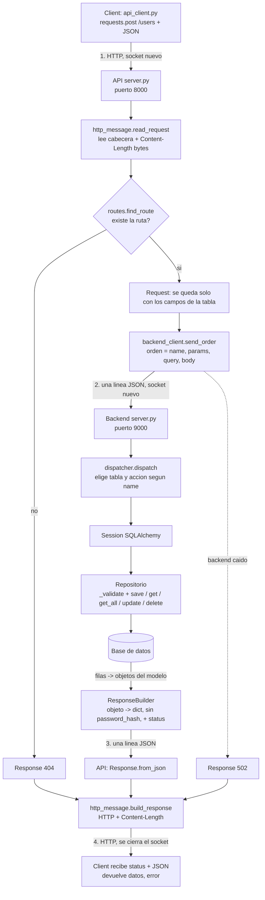

# API de FoodCraft

Refactoring: separar **client** (la app de terminal), **API** y **backend**. Todo hecho a mano.
Solo se usa la biblioteca estandar de Python en la API y el backend, y la libreria `requests` en el client.

## Arquitectura

```
Cliente  --HTTP/JSON-->  API (src/api)  --orden JSON-->  Backend (src/backend)  -->  Dominio/BD (src/domain)
requests                 un socket por    un socket por    procesa la orden          repositorios, SQLAlchemy
                         peticion         orden
```

1. **Cliente**: elige el metodo (POST crea, GET lee, PUT actualiza, DELETE borra), convierte los datos a JSON y los envia con `requests`. Puede estar en otro equipo (IP + puerto).
2. **API** (`src/api`): es la puerta de entrada. Lee la peticion HTTP, busca la ruta, se queda con los campos validos de la tabla y **reenvia la orden al backend**. No procesa datos ni toca la BD: **no importa `domain` ni `backend`**.
3. **Backend** (`src/backend`): recibe la orden, la ejecuta con los repositorios y devuelve el resultado. Es el unico que usa `domain/`.
4. **Dominio**: repositorios y base de datos que ya existian.

Cada pieza puede estar en un equipo distinto: la API necesita saber donde esta el backend (`BACKEND_HOST`, `BACKEND_PORT`), y solo el backend necesita acceso a la BD.

### Protocolo API -> Backend

Un socket nuevo por orden. Cada mensaje es **una linea JSON** acabada en `\n`:

```
API -> Backend: {"name": "user.add", "params": {}, "query": {}, "body": {"username": "ana"}}
Backend -> API: {"status": 201, "body": {"user_id": 1, "username": "ana"}}
```

La API valida lo minimo (ruta existente, JSON correcto, solo campos de la tabla). El backend valida con el `_validate` de los repositorios; su `ValueError` sale como 400.

### Diagrama de flujo (una peticion, ida y vuelta)



Resumen en palabras:
1. El client envia HTTP a la API.
2. La API lo lee, busca la ruta, lo convierte en una orden y la manda al backend.
3. El backend (lo que antes hacia el backoffice) ejecuta la orden: el dispatcher llama al repositorio, el repositorio valida y lee/escribe en la BD, y el ResponseBuilder devuelve `status` + `body`.
4. La API convierte esa respuesta en HTTP y la devuelve al client.

### Estado

| Pieza | Fichero | Estado |
|---|---|---|
| URLs | `api/routes.py` | Hecho |
| Requests + JSON | `api/api_requests.py` | Hecho |
| Response + JSON | `api/responses.py` | Hecho |
| Leer peticion / construir respuesta HTTP | `api/http_message.py` | Hecho |
| Enviar orden al backend | `api/backend_client.py` | Hecho |
| Servidor de la API | `api/server.py` | Hecho |
| Servidor del backend | `backend/server.py` | Hecho |
| Dispatcher (orden -> repositorio) | `backend/dispatcher.py` | Hecho (las 48 rutas) |
| ResponseBuilder | `backend/responses.py` | Hecho |
| Client con `requests` | `foodcraft/` | Hecho |

## Paso 1. Analisis del backoffice

| Entidad | Operaciones en el backoffice |
|---|---|
| Users, Recipes | Add, Update, Delete, Get, GetAll |
| Categories, Ingredients, Ratings | Solo GetAll |

## Paso 2. Tablas (11)

| Tabla | Campos |
|---|---|
| users | user_id, username, email, password_hash, created_at |
| recipe | recipe_id, user_id, title, description, prep_time, cook_time, servings, created_at |
| category | category_id, name |
| ingredient | ingredient_id, name |
| rating | rating_id, user_id, recipe_id, stars, comment, created_at |
| favorite | user_id, recipe_id |
| follow | follower_id, followed_id |
| recipe_category | recipe_id, category_id |
| recipe_ingredient | recipe_id, ingredient_id, quantity, unit |
| recipe_image | image_id, recipe_id, image_url |
| recipe_step | step_id, recipe_id, step_number, instruction, image_url |

## Paso 3. URLs ([routes.py](./routes.py))

Reglas:
1. Recurso en plural: `/users`, `/recipes`.
2. El metodo HTTP es la accion: `POST` = Add, `GET /x` = GetAll, `GET /x/{id}` = Get, `PUT /x/{id}` = Update, `DELETE /x/{id}` = Delete.
3. Las tablas hijas cuelgan de su padre: `/recipes/{id}/steps`.
4. Cada ruta tiene un nombre (`recipe.add`) que usara el servidor para saber que ejecutar.
5. Los filtros van en la query: `GET /recipes?title=pasta`.

Cada ruta es una tupla `(metodo, url, nombre)`. `find_route(metodo, ruta)` devuelve `(nombre, parametros)`, por ejemplo `("recipe_step.get_all", {"id": "7"})`, o `None`.

| Recurso | URLs |
|---|---|
| users, recipes, categories, ingredients, ratings | CRUD completo (5 rutas cada uno) |
| consultas | `GET /users/{id}/recipes`, `GET /recipes/{id}/ratings` |
| favorite | `GET, POST /users/{id}/favorites` · `DELETE /users/{id}/favorites/{recipe_id}` |
| follow | `GET /users/{id}/following`, `GET /users/{id}/followers`, `POST /users/{id}/following`, `DELETE /users/{id}/following/{followed_id}` |
| recipe_category | `GET, POST /recipes/{id}/categories` · `DELETE /recipes/{id}/categories/{category_id}` |
| recipe_ingredient | `GET, POST /recipes/{id}/ingredients` · `PUT, DELETE /recipes/{id}/ingredients/{ingredient_id}` |
| recipe_image | `GET, POST /recipes/{id}/images` · `DELETE /recipes/{id}/images/{image_id}` |
| recipe_step | `GET, POST /recipes/{id}/steps` · `PUT, DELETE /recipes/{id}/steps/{step_id}` |

Total: 48 rutas. El id de un recurso va en la URL, no en el cuerpo.

## Paso 4. Requests ([api_requests.py](./api_requests.py))

- `FIELDS`: los campos de cada tabla. **Todos opcionales**: se puede enviar solo una parte.
- `Request(tabla, datos)`: se queda solo con los campos que existen en la tabla e ignora el resto.
- `request.to_json()`: datos -> texto JSON (serializar).
- `Request.from_json(tabla, texto)`: texto JSON -> datos (deserializar).

```python
r = Request.from_json("recipe", '{"title": "Pasta", "foo": 1}')
r.data         # {"title": "Pasta"}
```

## Paso 5. Responses ([responses.py](./responses.py))

- `Response(status, body)`: lo que la API devuelve al client.
- `response.to_json()` / `Response.from_json(status, texto)`: serializar y deserializar.
- `Response.error(status, mensaje)`: respuestas de error propias de la API (404 ruta, 400 JSON roto, 502 backend caido).

El `ResponseBuilder` (respuestas con datos de la BD) **vive en el backend**: ver Paso 8.

## Paso 6. Mensajes HTTP ([http_message.py](./http_message.py))

Request y Response llevan los **datos**; este fichero los pasa a **bytes HTTP** (transporte). Solo lo usa el servidor, `requests` ya lo hace en el client.

```
POST /recipes HTTP/1.1\r\n
Content-Length: 33\r\n
\r\n                         <- linea vacia: fin de cabeceras
{"title": "Pasta", ...}     <- exactamente 33 bytes
```

| Funcion | Que hace |
|---|---|
| `read_request(sock)` | (1) lee hasta la linea vacia, (2) saca metodo, ruta y query de la primera linea, (3) lee `Content-Length` bytes de cuerpo |
| `build_response(Response)` | construye el texto HTTP; `Content-Length` se cuenta en **bytes**, no en caracteres |

`Content-Length` existe porque un socket TCP es un flujo continuo y no marca donde acaba el mensaje.
Sin validaciones a proposito: se asume que el client envia HTTP correcto.

## Paso 7. Servidor de la API ([server.py](./server.py)) y envio al backend ([backend_client.py](./backend_client.py))

Es un *listener*: se queda esperando clientes y, por cada uno, repite siempre lo mismo. No toca la BD.

1. Abre un socket de escucha en `0.0.0.0:8000` (`0.0.0.0` permite conexiones desde otros equipos).
2. `accept()` espera a un cliente; cada cliente llega con su **propio socket nuevo** y se atiende **uno a la vez** (sin hilos por ahora: hasta que `handle` no termina, el siguiente espera).
3. `handle(client)`: `read_request` -> `find_route` -> `Request.from_json` -> `send_order` -> `build_response` -> `sendall` -> `close`.
4. `send_order(name, params, query, body)` abre un socket nuevo contra el backend, envia la orden (una linea JSON) y lee la respuesta (otra linea JSON).

| Situacion | Respuesta de la API |
|---|---|
| Ruta inexistente | 404 |
| JSON roto en el cuerpo | 400 |
| Backend caido o inalcanzable | 502 Bad Gateway |
| Error inesperado | 500 |
| Cualquier otro caso | lo que devuelva el backend |

Arrancar (desde la raiz del proyecto):

```powershell
$env:PYTHONPATH = "src"
python -m backend.server     # primero el backend (puerto 9000)
python -m api.server         # despues la API (puerto 8000)
```

## Paso 8. Backend ([../backend/](../backend))

Recibe las ordenes de la API y las ejecuta contra la BD. Es el unico que importa `domain/`.

- [`server.py`](../backend/server.py): igual que el de la API pero lee una linea JSON. Por defecto escucha en `127.0.0.1:9000` (solo la propia maquina); para otro equipo, `BACKEND_HOST=0.0.0.0`.
- [`responses.py`](../backend/responses.py): `Response` y `ResponseBuilder`. `RESPONSE_FIELDS` define los campos que se devuelven por tabla (users nunca devuelve `password_hash`).

| Metodo de `ResponseBuilder` | Status |
|---|---|
| `ok(tabla, entidad)`, `ok_list(tabla, entidades)` | 200 |
| `created(tabla, entidad)` | 201 |
| `no_content()` | 204 |
| `bad_request(mensaje)` | 400 |
| `not_found(mensaje)` | 404 |
| `server_error(mensaje)` | 500 |

- [`dispatcher.py`](../backend/dispatcher.py): traduce el nombre de la orden (`user.add`) a una accion sobre la BD. Cubre las 48 rutas con **dos funciones genericas**.

`dispatch(order)`: separa `tabla.accion`, convierte los ids de la URL a `int` y llama a una de las dos funciones.

**1. `main_actions`: tablas con repositorio** (`MAIN_TABLES`: user, recipe, category, ingredient, rating)

| Accion | Que hace | Respuesta |
|---|---|---|
| `get_all` | `repo.get_all()` (en recipe, con `?title=` usa `search_by_title`) | 200 |
| `get_by_author` / `get_by_recipe` | consultas del repositorio | 200 |
| `add` | `repo.save(Modelo(**datos))` + commit (en recipe se busca el autor, que el repositorio exige) | 201 |
| `get` | `repo.get(id)` | 200 / 404 |
| `update` | cambia solo los campos enviados + commit | 200 / 404 |
| `delete` | `session.delete` + commit | 204 / 404 |

**2. `child_actions`: tablas hijas** (`CHILD_TABLES`: favorite, follow, recipe_category, recipe_ingredient, recipe_image, recipe_step). No tienen repositorio, se usa el modelo directamente. Cada una se describe con una tupla `(modelo, columna_padre, columna_clave)`:

| Tabla | columna_padre (el `{id}` de la URL) | columna_clave (la ultima parte de la URL) |
|---|---|---|
| favorite | user_id | recipe_id |
| follow | follower_id | followed_id |
| recipe_category | recipe_id | category_id |
| recipe_ingredient | recipe_id | ingredient_id |
| recipe_image | recipe_id | image_id |
| recipe_step | recipe_id | step_id |

`get_all` filtra por la columna padre; `add` crea la fila usando el id de la URL como padre; `update` y `delete` buscan por padre + clave. `follow` ademas tiene `get_followers` (filtra por `followed_id`).

**Errores**
- `ValueError` (id no numerico o validacion del repositorio) -> 400.
- `IntegrityError` / `FlushError` (duplicado, o dato relacionado que falta) -> 400.
- Cualquier otro error lo captura `backend/server.py` -> 500.

**Pruebas**: se probaron las rutas con `requests` real contra la cadena completa (cliente -> API -> backend), con SQLite en un fichero: CRUD, tablas hijas, errores 400/404, y backend caido (502). Se comprobo que importar `api` **no carga** `domain` ni `backend`. **No se ha probado contra Postgres**: la BD remota no era accesible desde el entorno de desarrollo.

## Paso 9. Client ([../foodcraft/](../foodcraft))

La CLI ya no usa `Session` ni repositorios: **no importa `domain` ni `sqlalchemy`**. Solo habla con la API.

- [`api_client.py`](../foodcraft/api_client.py): funciones de pocas lineas sobre `requests`. Cada llamada es suelta (sin `Session`), asi abre un socket nuevo.

| Funcion | Peticion |
|---|---|
| `get_all("users")` | `GET /users` |
| `get("users", 7)` | `GET /users/7` |
| `create("users", datos)` | `POST /users` |
| `update("users", 7, datos)` | `PUT /users/7` |
| `delete("users", 7)` | `DELETE /users/7` |

Todas devuelven `(datos, error)`. Si la API responde 400/404/502 o no esta disponible, `error` trae el mensaje y `datos` es `None`.

- La URL de la API sale de la variable `API_URL` (por defecto `http://127.0.0.1:8000`). Se usa la IP y no `localhost` porque en Windows `localhost` puede tardar ~2 s.
- [`users_views.py`](../foodcraft/users_views.py), [`recipes_views.py`](../foodcraft/recipes_views.py) y [`app_ui.py`](../foodcraft/app_ui.py) mantienen los mismos menus de Rich; solo cambia de donde salen los datos. `show_error(error)` muestra el error en rojo.

**Cambios en pantalla** (la API no devuelve esos datos todavia):

| Listado | Antes | Ahora |
|---|---|---|
| Users | columnas Recipes y Ratings (recuentos) | se quitan |
| Recipes | nombre del autor | `Author ID` |
| Ratings | nombre de usuario y titulo de receta | `User ID` y `Recipe ID` |

Arrancar todo (desde la raiz, con `$env:PYTHONPATH = "src"`):

```powershell
python -m backend.server        # terminal 1
python -m api.server            # terminal 2
python -m foodcraft.app_ui      # terminal 3
```

**Pruebas**: CLI con respuestas simuladas contra la cadena completa (CLI -> API -> backend -> SQLite): alta, listado, edicion, consulta, borrado, error 404 y API caida. No probado con Postgres.

## Decision: libreria `requests` en el client

- Client: `requests` (en `requirements.txt`). Cada llamada suelta (`requests.post(...)`, sin `Session`) abre un socket nuevo.
- API y backend: `socket` propio; `requests` solo envia, no recibe.
- Se llama `api_requests.py` para no chocar con la libreria `requests`.

## Estructura

```
src/api/                  (no importa domain ni backend)
  __init__.py             exporta Request, Response, find_route
  routes.py               URLs
  api_requests.py         Request
  responses.py            Response
  http_message.py         leer peticion / construir respuesta HTTP
  backend_client.py       enviar la orden al backend
  server.py               listener de la API (puerto 8000)
  README.md
src/backend/              (unico que usa domain)
  server.py               listener del backend (puerto 9000)
  dispatcher.py           orden -> repositorio / modelo
  responses.py            Response + ResponseBuilder
src/domain/               sin cambios
src/foodcraft/            client: api_client.py + vistas (no importa domain)
```

## Pendiente (para revisar juntos)

1. **Despliegue**: la API necesita `src/api`; el backend necesita `src/backend`, `src/domain` y el `.env` con la URL de la BD. Falta documentar cada arranque por separado.
2. **Datos relacionados**: crear un registro con un id inexistente da 400 por la restriccion de la BD. En SQLite no se comprueba; en Postgres si.
3. **Datos extra de los listados**: la CLI muestra ids en vez de nombres (autor, usuario, receta) y sin recuentos. Mejorar en el backend o con mas llamadas.
4. **Cliente**: solo Users y Recipes tienen menu de acciones completo (como antes); Categories, Ingredients y Ratings siguen solo en listado aunque la API ya soporta su CRUD.
5. **Seguridad**: `password_hash` lo envia el client (y el update de usuario no lo cambia); no hay autenticacion; el canal API -> backend no esta cifrado.
6. **Limitaciones de `http_message`** y del protocolo API -> backend: si el otro lado se corta a mitad de mensaje, el servidor se queda esperando y, al atender un cliente a la vez, bloquea a todos los demas.
7. **Hilos**: API y backend atienden un cliente a la vez. Pendiente anadir `threading` para atender varios a la vez.
7. **Paginacion** de listados.
8. **README raiz**: sigue describiendo la CLI antigua (acceso directo a BD).
